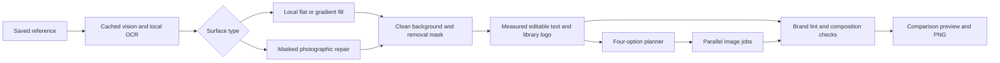

# Output quality review

Branch: `review/output-quality`, based on `main` at `cbc13f7` (this repository has no `master`). Changes are not merged or pushed.

## Review checkpoints

1. Contracts: optional source/cleaned-image provenance and explicit quality findings.
2. Cleanup: source analysis cache, flat-surface reconstruction, masked photographic repair, bounded failure handling and saved intermediate results.
3. Typography and layouts: real font measurements, consistent line height, balanced templates and composition checks.
4. Studio: live option cards, Original / Clean background / Final comparison, actionable quality details and clear editing/export controls.
5. Validation and presentation: representative image benchmark, real-provider/browser checks, before/after examples and measured timings.

Each checkpoint is committed separately. Review with `git log main..review/output-quality --oneline` and `git diff main...review/output-quality`. Returning to `main` restores the accepted code baseline; runtime designs are separate from Git.

Implemented checkpoints 1–5. Final verification: 64 backend tests passed, two optional live checks skipped; production build and TypeScript passed; the complete real-model Playwright demo passed. Final OCR-availability/save guards were then checked with backend tests and a real saved-reference/browser comparison check. No merge or push was performed.

The acceptance standard is a visibly clean background, editable text that fits, an intact library logo, and a useful final export. Tests support that standard; they do not establish photographic perfection. Review findings remain visible when automated checks cannot establish a clean result.

## Browser preview

Open `http://127.0.0.1:5174/`. The review API is on `127.0.0.1:8002`, with `DATA_DIR=./data/output-quality-preview` and real models enabled. Its database and files were copied from the current brand once; changes made in the preview do not update the original database. No public hosting or push is involved.

Attach a reference and choose **Clean & make editable** to preserve its composition, or **Create four options** to explore art directions. Focus a card and switch **Original / Clean background / Final design**. The clean-background tab shows the cleaned reference, including when the focused card is a newly composed option. It can be downloaded separately. The final tab and PNG export use editable canvas layers.

## System design

- `app/decompose/analysis.py`: source fingerprint, reusable raw detections, parallel Flash/OCR and remaining-text checks. Device/product screenshot lettering remains inside its photo.
- `app/decompose/cleanup.py`: flat/gradient reconstruction, glyph masks where foreground color is reliable, same-size alpha masks, opacity validation, at most two repair attempts and compositing confined to the selected pixels. Uncertain foregrounds use a bounded region. Brand logos are removed from the working model input before repair.
- `app/core/typography.py`: actual font-file measurements, variable-font weight and a shared 1.2 line height. Small references become a 1080px editable canvas while cleaning stays at the original pixel dimensions. Upscaling does not invent photographic detail.
- `app/core/quality.py`: fresh reports on saves/publication: lint, clipping, missing/low-resolution assets, text collisions and available background checks. Direct saves invoke no models.
- `app/generate/variants.py`: six layouts with supporting copy, safe spacing, actual-font fitting and up to four image workers. Completed options publish immediately; they do not wait behind a slower first option.
- Studio: explicit clean/recompose choices, live cards, source/clean/final comparison, background export and findings in the preview. Generated-image edit targets are verified from stored asset sources and included explicitly in agent context. One bounded corrective model turn handles a requested edit that produced no changes.

Stored intermediate assets carry processing times, cleanup methods, OCR availability and cache information. Failed cleanup is disclosed and not reused as a clean result. Completed threads persist; active jobs remain in memory and can be lost on API restart.

The masked edit requests opaque output. Transparent areas in the mask identify the editing area; the API can treat that mask as guidance, so local compositing also enforces preservation. See the [official OpenAI Images edit reference](https://developers.openai.com/api/reference/python/resources/images/methods/edit).

## Output review and measured checks

The XERO reference was checked with real providers and headless Chromium. Cleaned copy and logo areas were visually inspected; both headline lines, CTA and a library logo are separately editable. The final scene has no text-fit errors. Original margin warnings remain intentionally visible, and the 338×420 source photo is flagged when enlarged. DM Sans remains a disclosed fallback until an actual brand font is supplied.

Measured XERO processing: **6.193 s analysis**, **0.186 s cleanup**, **6.418 s total decomposition**, **17.598 s including agent turns and browser capture**. Background cleanup used **zero image-model calls** for this flat-surface example.

The committed preview was checked again with successful native OCR verification: cached source analysis plus a fresh cleanup completed in **0.197 s**, then reuse of both analysis and cleanup completed in **0.019 s** internally (**0.268 s** including HTTP polling). These are repeated-reference timings, not a promise for unseen images.

The complete headless browser run used real providers and passed the comparison tabs/background download, four options, B headline/color edit, C library swap, A generated-image edit, direct preview text editing with zero model routes, subsequent chat context, persistence, parent versions, 403 for brand-image editing and PNG export. Final PNG and screenshots were visually inspected. Generation speed varied: one run produced four options in 32.965 s; the final complete run took 134.313 s. Provider latency remains a material limit.

| Final complete browser step | Seconds |
| --- | ---: |
| Brand folder, extract, confirm, Studio | 34.249 |
| Upload, decomposition, four options and comparison/export checks | 134.313 |
| Headline + navy background edit | 10.715 |
| Product UI library swap | 23.356 |
| Generated office-at-sunrise image edit | 24.776 |
| Direct preview text edit, no model routes | 0.566 |
| Next chat sees direct correction | 2.918 |
| Persistence, library, PNG, legacy redirect | 1.513 |

Artifacts are gitignored: `data/review-{live-check.json,clean-background.png,final-design.png}`, `data/quality-benchmark/`, and the single browser test's `test-results/` directory. The review guide records results so evidence survives removal of runtime artifacts. The production bundle still has Vite's non-fatal size warning (approximately 788 kB before gzip).

Run `.venv/bin/python scripts/benchmark_quality.py --real` for six reproducible cases. Outputs are `data/quality-benchmark/index.html`, originals, expected backgrounds, cleaned PNGs, masks and `results.json`. Four simple surfaces use no model (2–3 ms each). Two textured cases used one masked call each (**12.963 s**, **16.804 s**). All six preserved unmasked pixels exactly. Solid-surface errors were zero; the gradient's masked mean absolute error was 1.848/255. Texture reconstruction is approximate and can retain seams or a softened letter-shaped texture; inspect the gallery rather than interpreting mechanical preservation as a visual pass. These procedural cases complement the real XERO example and the browser demo, not a broad photographic quality certification.

## Presentation walkthrough

1. Explain the task: turn a reference into an editable design that uses an existing brand.
2. Show the original next to the cleaned-background tab; point out that copy/logo pixels are removed and the photo stays intact.
3. Switch to Final design and double-click a headline. Show the saved correction, without a model wait.
4. Generate four directions, then ask for a headline/color change and a library photo swap. Show the new version and its preserved parent.
5. Export the final PNG and the separate clean background. Show quality findings honestly, including fallback fonts or low-resolution inputs.

## Accept or reject

Inspect each checkpoint with `git log main..review/output-quality --oneline` and `git show <commit>`. The accepted baseline remains `main` at `cbc13f7`. No changes have been merged. A normal fast-forward merge can accept the complete branch after review; selected commits can instead be reviewed individually. Switching back to `main` restores the code baseline. Stop/restart preview processes when changing branches; Git does not roll back runtime databases.
